<div align="center">

# 🛰️ ExoDex

### Explore alien worlds, scan unknown lifeforms, build the database.

**A creature-discovery game about scientific exploration, built with Python, Pygame and SQLite.**
Instead of catching monsters, you're a xenobiologist. You land on procedurally generated planets,
scan and capture **220 alien species**, sequence their DNA, and fill a real SQLite research database.

[](https://jaigod.github.io/exodex/)
[](https://github.com/JaiGod/exodex/releases/latest)


[](https://github.com/JaiGod/exodex/actions/workflows/ci.yml)


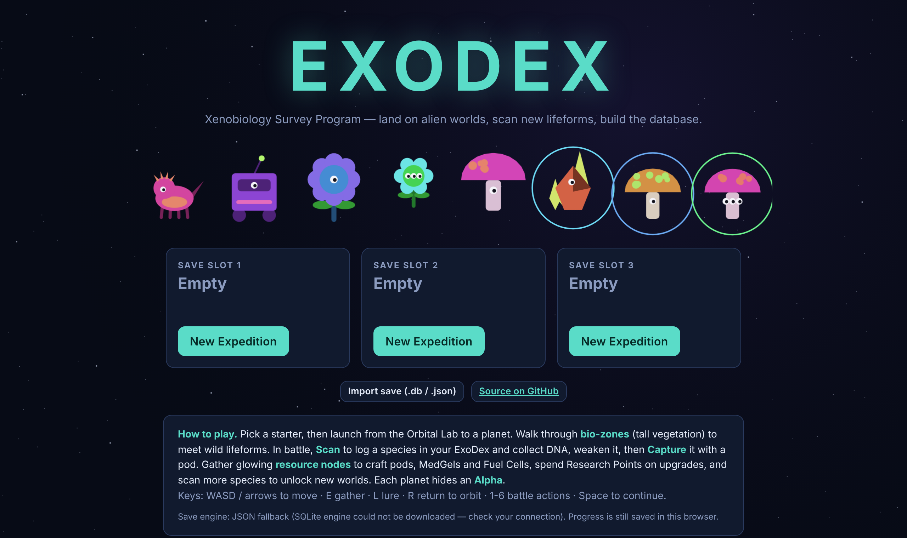

</div>

---

## 🔗 Quick links

| | |
|---|---|
| 🎮 **Play now (browser, desktop + mobile)** | **https://jaigod.github.io/exodex/** |
| 💾 Windows desktop build | [Releases → ExoDex.exe](https://github.com/JaiGod/exodex/releases/latest) |
| 🏗️ Architecture & UML | [docs/ARCHITECTURE.md](docs/ARCHITECTURE.md) |
| 🗄️ Database schema & example SQL | [docs/DATABASE.md](docs/DATABASE.md) · [data/schema.sql](data/schema.sql) |
| 🧬 Species generator | [tools/generate_species.py](tools/generate_species.py) |
| ✅ Tests | [tests/test_core.py](tests/test_core.py) |

---

## 🌌 The idea

Most monster-catchers are about battling. **ExoDex is about discovery.** Every planet is a
procedurally generated ecosystem. Every creature belongs to a scientific *kingdom* (Fauna, Flora,
Fungoid, Microbe, Mechanoid, Crystalline), has a genome, a trait, a habitat and a recorded height
and mass. The goal is to **complete the research database**: scanning gives you data and DNA,
capturing gives you specimens, and the Research Lab turns DNA into science.

> *Pokémon + Stardew Valley + National Geographic, set on exoplanets.*

## 📸 Screenshots

| Orbital Lab: galaxy map | Planet exploration (procedural) |
|---|---|
| 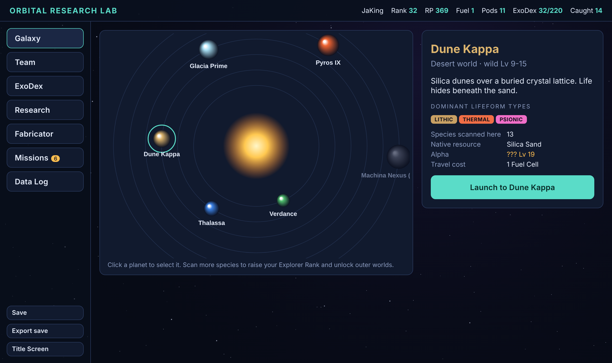 | 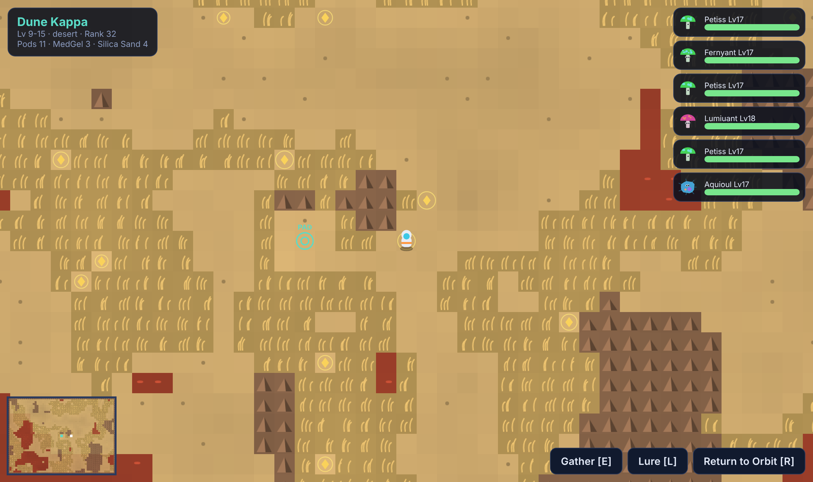 |
| **Turn-based battle** | **Alpha encounter** |
| 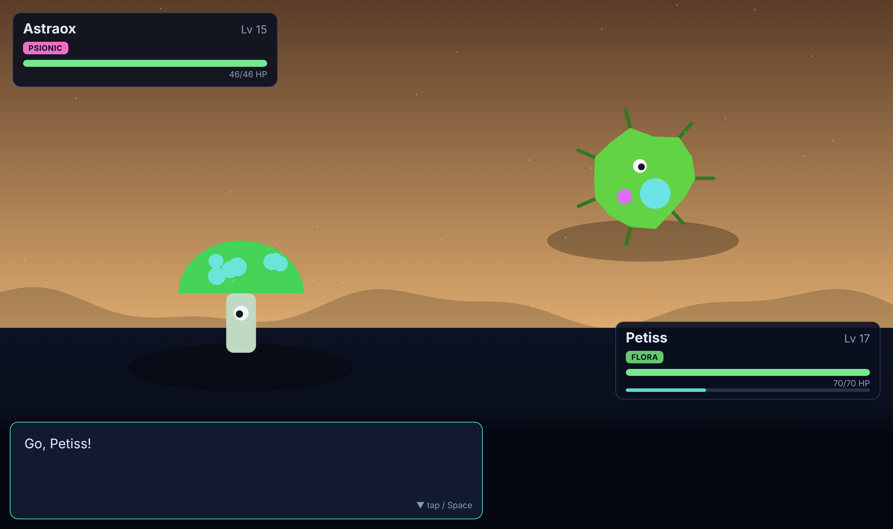 | 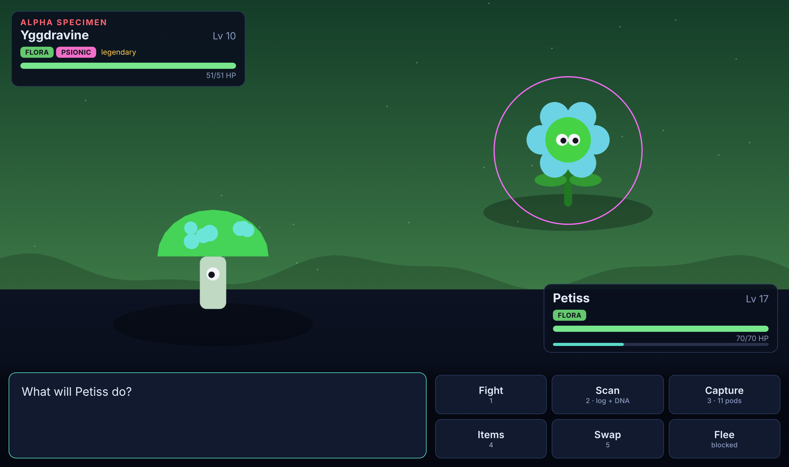 |
| **ExoDex discovery journal** | **Team, genome & traits** |
| 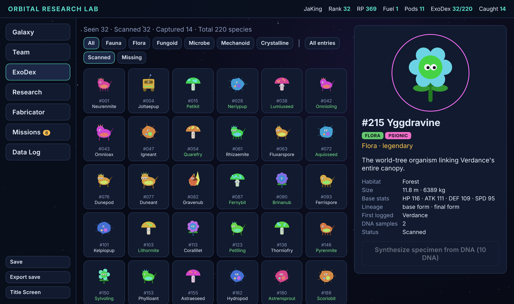 | 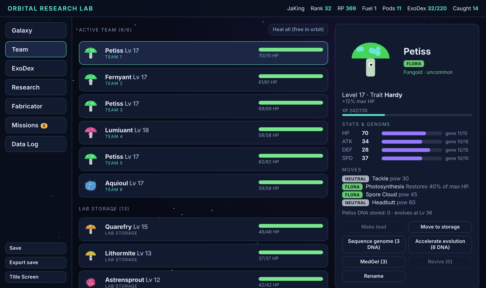 |
| **Research upgrades** | **Fabricator (crafting)** |
| 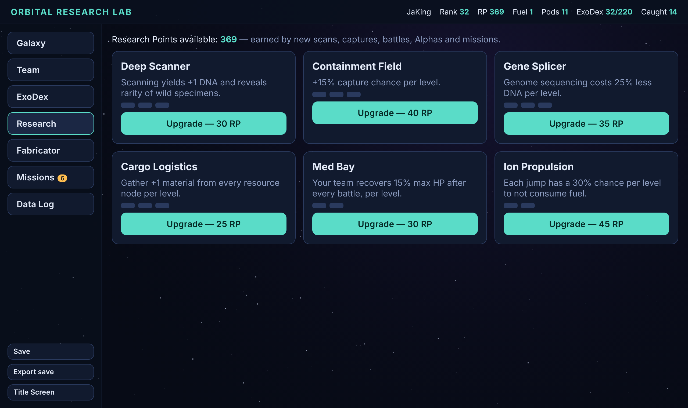 | 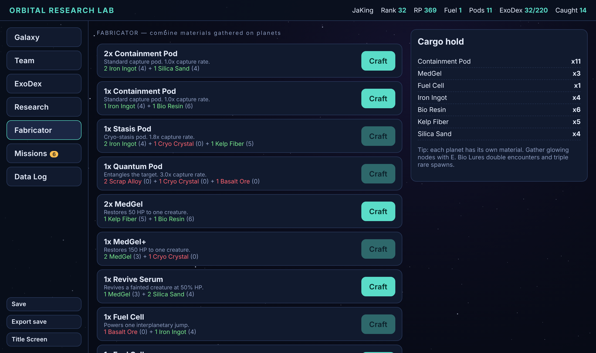 |

<p align="center">
  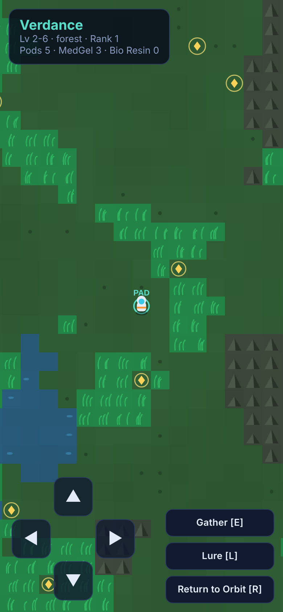
  &nbsp;&nbsp;
  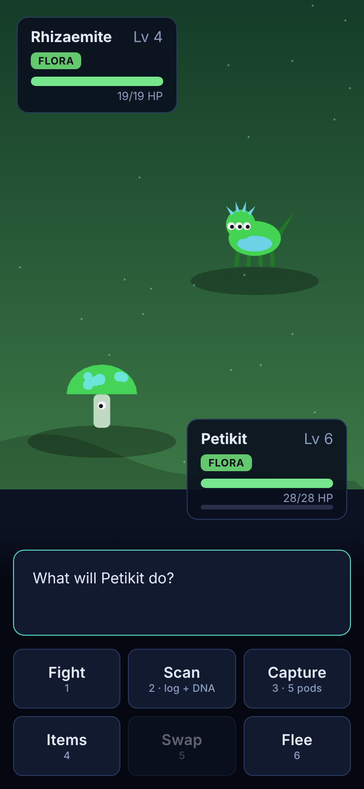
  &nbsp;&nbsp;
  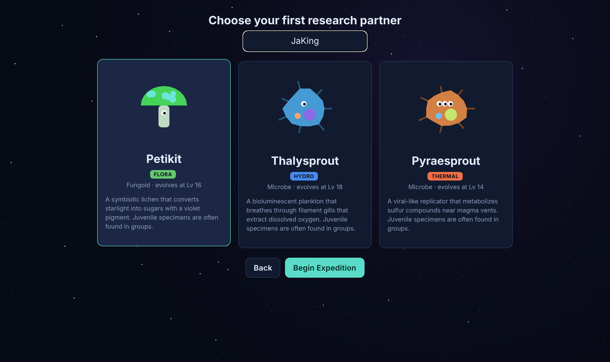
</p>

## ✨ Features

- **220 alien species** across 6 kingdoms and 8 types (Thermal, Cryo, Hydro, Lithic, Flora, Synth, Volt, Psionic), in 96 evolution families plus 10 legendaries
- **Procedural generation everywhere.** Noise-based planet terrain, species names, stats and learnsets, a genome and trait for every individual, 1/64 *aberrant* colour mutations, and **procedurally drawn creature art** (no image assets at all)
- **6 explorable planet types:** forest, ocean, desert, ice, lava and an artificial Dyson-ring world, unlocked by raising your Explorer Rank
- **Turn-based battles** with a type chart, same-type bonus, crits, burn/freeze/poison/stun/sleep, stat stages and an enemy AI
- **Scan → DNA → Research loop.** Scan to log species and collect DNA, then spend it to **sequence genomes**, **accelerate evolution**, or **synthesize** a specimen
- **Evolution** at set levels, with new moves learned on level-up
- **Crafting.** Gather each planet's resource and fabricate capture pods, MedGels, revives, fuel cells and lures
- **Research tree:** Deep Scanner, Containment Field, Gene Splicer, Cargo Logistics, Med Bay, Ion Propulsion
- **18 missions** with rewards, plus **6 Alpha bosses** (legendaries) guarding each world
- **Save/load with SQLite.** Three save slots, and every save is a real `.db` file
- **In-game SQL console** (browser): query your own save, e.g. "win rate by planet"

## 🧠 Technical highlights

| | |
|---|---|
| **One schema, two engines** | The Pygame build uses Python's `sqlite3`. The browser build runs SQLite compiled to WebAssembly ([sql.js](https://sql.js.org)) with the **same `schema.sql`**. Export a `.db` from the website and it loads in the desktop game, and the reverse works too. |
| **Deterministic cross-language procgen** | `Mulberry32` and value noise are written in Python **and** JavaScript with identical 32-bit integer maths, so every planet is **bit-for-bit the same** in both versions. This was checked for all 6 planets. |
| **Separation of concerns** | Rendering (`scenes/`, `ui.js`), rules (`session`, `battle`, `creature`) and persistence (`database`, `store.js`) are separate layers. The rules layer is tested headlessly. |
| **Data-driven design** | All content comes from `tools/generate_species.py` → `data/gamedata.json`, a reproducible, seeded build step that CI verifies. |
| **Relational modelling** | 16 tables with foreign keys, a self-referencing evolution chain, a many-to-many learnset table, and indexed lookups. See the [ERD](docs/DATABASE.md). |

### Class diagram

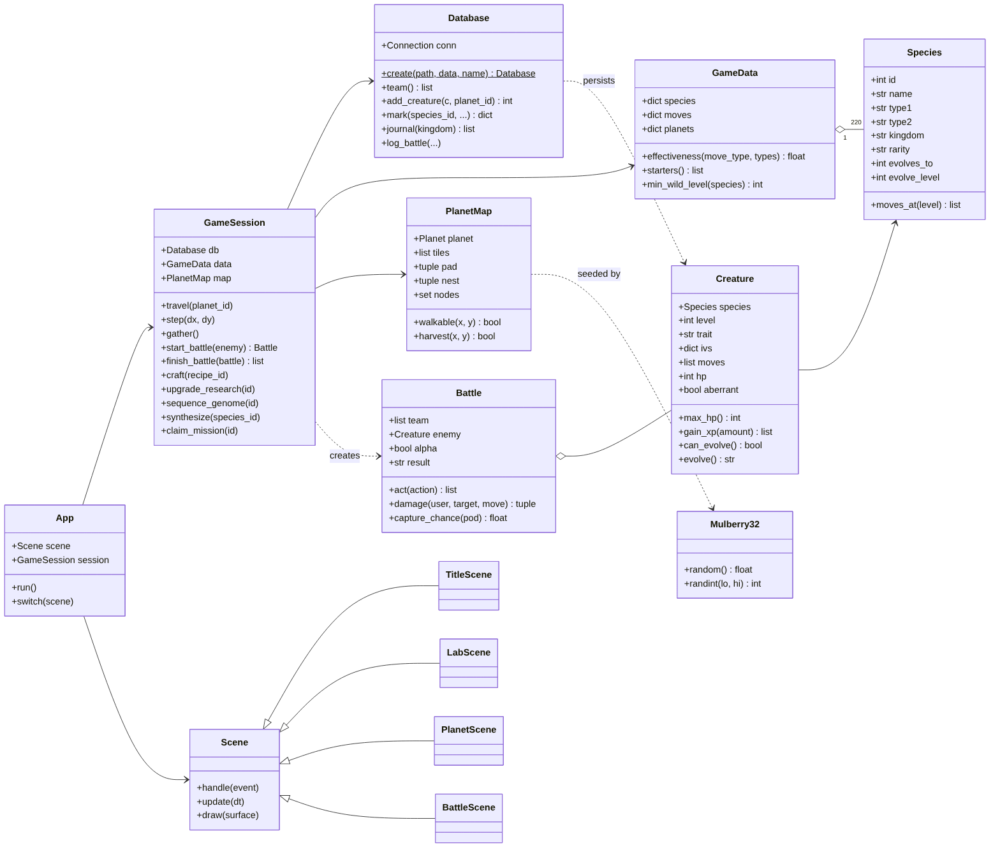

### Database (ERD)

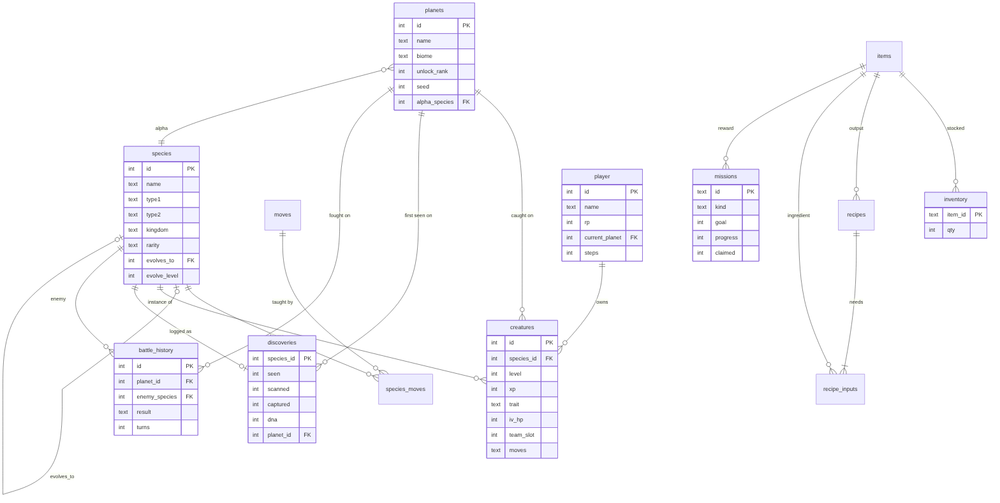

## 🕹️ How to play

| Action | Keyboard | Touch |
|---|---|---|
| Move | **WASD** / arrow keys | on-screen D-pad, or tap a side of the map |
| Gather resource node | **E** / Space | *Gather* button |
| Use a Bio Lure | **L** | *Lure* button |
| Return to orbit (on the landing pad) | **R** | *Return to Orbit* |
| Battle actions | **1-6** (Fight, Scan, Capture, Items, Swap, Flee) | buttons |
| Next message | **Space** / Enter | tap the message box |

1. **Choose a starter**: a Flora, Hydro or Thermal lifeform.
2. **Launch to Verdance** (free shuttle). Walk through the tall **bio-zones** to meet wildlife.
3. In battle, **Scan** first (new ExoDex entry, DNA, Research Points). Then weaken the creature and **Capture** it.
4. Gather the glowing ◆ nodes, then craft more pods and **Fuel Cells** at the Fabricator.
5. Scan more species to raise your **Explorer Rank** and unlock Thalassa, Dune Kappa, Glacia Prime, Pyros IX and Machina Nexus.
6. Defeat or capture the **Alpha** on each world (marked in red, far from the landing pad).

## 🚀 Run it locally

**Browser version:** open `index.html`, or serve the folder:
```bash
python -m http.server 8000      # then visit http://localhost:8000
```

**Desktop version (Python + Pygame):**
```bash
git clone https://github.com/JaiGod/exodex.git
cd exodex
pip install -r requirements.txt
python main.py
```

**Tests and data tools:**
```bash
python -m unittest discover tests -v   # 16 tests: data, procgen, battles, sessions, save files
python tools/generate_species.py       # regenerate the 220-species dataset (deterministic)
python tools/build_web.py              # bundle data + schema for the browser build
```

## 📁 Project structure

```
exodex/
├── main.py                 # desktop entry point (Pygame)
├── index.html              # browser entry point (GitHub Pages)
├── exodex/                 # Python package
│   ├── rng.py              #   cross-platform PRNG + fractal noise
│   ├── data.py             #   typed catalogue (Species, Move, Planet), type chart
│   ├── creature.py         #   specimens: stats, genome, traits, XP, evolution
│   ├── procgen.py          #   planet maps + wild encounter tables
│   ├── battle.py           #   turn-based battle engine
│   ├── database.py         #   SQLite repository layer
│   ├── session.py          #   game rules / systems (the API the UI calls)
│   ├── sprites.py          #   procedural creature art
│   ├── app.py, ui.py       #   Pygame shell + widgets
│   └── scenes/             #   title, lab, planet, battle
├── web/                    # browser build (vanilla JS port + sql.js)
│   ├── js/                 #   rng, core, session, store, sprites, ui
│   └── css/style.css
├── data/
│   ├── schema.sql          # the SQLite schema shared by both builds
│   └── gamedata.json       # generated catalogue: 220 species, 53 moves, 6 planets...
├── tools/                  # dataset generator + web bundler
├── tests/                  # unit tests
└── docs/                   # architecture, database docs, UML, screenshots
```

## 🗺️ Roadmap

- [ ] Trading between save files (export a specimen as a `.db` row)
- [ ] Photo mode: capture creatures in their habitat for the journal
- [ ] Seasonal events and weather per biome
- [ ] Android build (Capacitor wrapper around the web version)

## 👤 Author

**Jaineil Rana** (JaKing). NASA HUNCH participant and game/simulation developer.

[](https://github.com/JaiGod)
[](https://www.linkedin.com/in/jaineil-rana-89005736a)
[](https://www.patreon.com/c/JaineilRana)

Licensed under the [MIT License](LICENSE).
