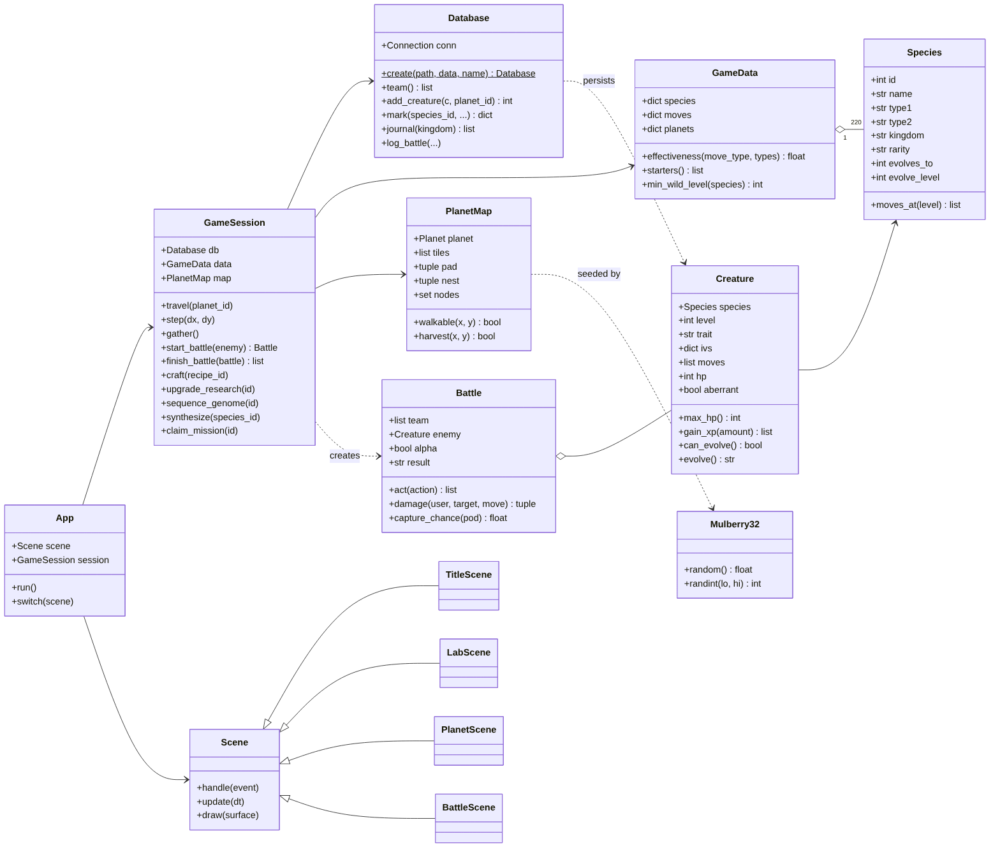
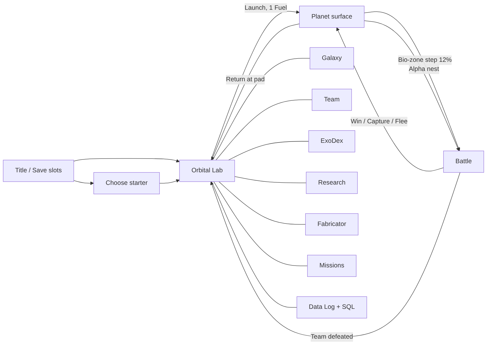

# ExoDex Architecture

ExoDex has **two front-ends that share one design**:

| Layer | Desktop (Python) | Browser (JavaScript) |
|---|---|---|
| Static data | `data/gamedata.json` (generated) | same file, bundled into `web/data.js` |
| Persistence | `exodex/database.py` → `sqlite3` | `web/js/store.js` → sql.js (SQLite in WebAssembly) |
| Rules | `exodex/session.py`, `battle.py`, `creature.py` | `web/js/session.js`, `web/js/core.js` |
| Procedural generation | `exodex/rng.py`, `procgen.py` | `web/js/rng.js`, `core.js` (bit-identical) |
| Sprites | `exodex/sprites.py` (vector recipe) | `web/js/sprites.js` (same recipe) |
| Rendering / input | `exodex/scenes/*` (Pygame) | `web/js/ui.js` (DOM + `<canvas>`) |

Both use the **same SQLite schema** (`data/schema.sql`), so a `.db` save exported from the
browser loads in the desktop game and vice versa. Both also generate **identical planets** from
the same seed. The test suite checks this.

## Module overview

```
exodex/
├── rng.py         Mulberry32 PRNG + value/fractal noise (32-bit integer maths, matches JS)
├── data.py        Loads gamedata.json into frozen dataclasses (Species, Move, Planet) + type chart
├── creature.py    Creature: stats from base stats + genome (IVs) + trait, XP curve, evolution
├── procgen.py     PlanetMap generation (noise → tiles, BFS reachability, nests, resource nodes)
│                  and wild-encounter tables weighted by rarity / stage / planet level
├── battle.py      Turn-based battle engine (pure logic): speed order, STAB, type chart,
│                  crits, status effects, stat stages, enemy AI, scanning and capture maths
├── database.py    SQLite repository: schema creation, catalogue seeding, CRUD, journal joins
├── session.py     GameSession: the rules layer the UI talks to (travel, explore, battle
│                  resolution, crafting, research, genome sequencing, missions)
├── sprites.py     Procedural creature art: species → list of vector primitives
├── ui.py          Pygame widgets (buttons, panels, bars, sprite cache)
├── app.py         Window, main loop, scene switching, toasts
└── scenes/        title.py, lab.py, planet.py, battle.py
```

The UI never touches SQL or game rules directly. It calls `GameSession`. That keeps the
gameplay unit-testable without opening a window (`tests/test_core.py`).

## Class diagram



<details><summary>Mermaid source</summary>

See [`docs/uml/classes.mmd`](uml/classes.mmd).
</details>

## Game flow



## Procedural generation

* **Planets.** Each planet has a seed. Two layers of 3-octave value noise give *elevation*
  (hazard below 0.34, rock above 0.70) and *moisture* (bio-zones above 0.55). The landing pad
  is cleared at the centre. A breadth-first search finds every reachable tile. The **Alpha nest**
  goes on the farthest reachable tile, and 26 resource nodes are scattered with Mulberry32.
* **Species.** `tools/generate_species.py` builds 96 evolution families (1–3 stages each)
  plus 10 legendaries, for 220 species. Names come from type-themed syllables. Stats scale
  by stage. Learnsets mix the species' own type, its secondary type, and neutral moves.
* **Individuals.** Every specimen rolls a genome (4 IVs, 0–15), one of 10 traits (Hardy,
  Regenerative, Bioluminescent...) and a 1/64 chance of an *aberrant* colour mutation.
* **Sprites.** Each species' `sprite_seed` drives a kingdom-specific body plan (fauna, flora,
  fungoid, microbe, mechanoid, crystalline): limbs, petals, spikes, eyes and colours.

## Battle maths

```
damage = ((2·L/5 + 2) · power · ATK/DEF) / 50 + 2
         × type effectiveness (×2 / ×0.5 per defending type)
         × STAB 1.25 × random 0.85–1.0 × crit 1.5 (1/16, doubled by Bioluminescent)

capture = (1 − ⅔·HP%) × rarity factor × pod multiplier × status bonus
          × (1 + 0.15·Containment research) × (0.5 if Alpha), clamped to 2–95 %
```

A capture makes three "shake" checks, each with probability `capture^(1/3)`.
