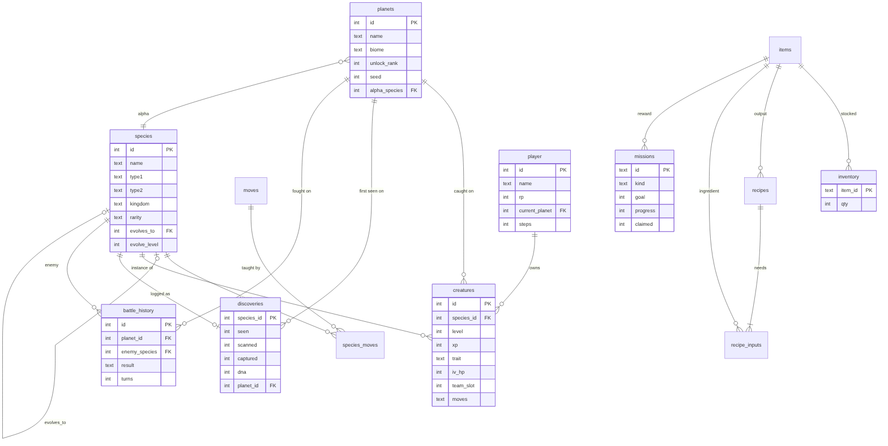

# ExoDex Database Schema

Every save file is a single SQLite database (`saves/slotN.db` on desktop, exported `.db` in the browser).
It contains the **static catalogue** (generated by `tools/generate_species.py`) and the **player's progress**, so a save is
self-describing and opens in any SQLite browser (e.g. [DB Browser for SQLite](https://sqlitebrowser.org/)).

Source of truth: [`data/schema.sql`](../data/schema.sql). Entity-relationship diagram:



## Tables

### `meta` — catalogue (2 rows in a new save)

| column | type | notes |
|---|---|---|
| `key` | TEXT | primary key |
| `value` | TEXT | not null |

### `species` — catalogue (220 rows in a new save)

| column | type | notes |
|---|---|---|
| `id` | INTEGER | primary key |
| `name` | TEXT | not null |
| `type1` | TEXT | not null |
| `type2` | TEXT |  |
| `kingdom` | TEXT | not null |
| `rarity` | TEXT | not null |
| `hp` | INTEGER | not null |
| `atk` | INTEGER | not null |
| `defense` | INTEGER | not null |
| `spd` | INTEGER | not null |
| `evolves_to` | INTEGER | → `species.id` |
| `evolve_level` | INTEGER |  |
| `family` | INTEGER | not null |
| `stage` | INTEGER | not null |
| `biomes` | TEXT | not null |
| `hue` | INTEGER | not null |
| `sprite_seed` | INTEGER | not null |
| `height_m` | REAL | not null |
| `mass_kg` | REAL | not null |
| `description` | TEXT | not null |

### `moves` — catalogue (53 rows in a new save)

| column | type | notes |
|---|---|---|
| `id` | INTEGER | primary key |
| `name` | TEXT | not null |
| `type` | TEXT | not null |
| `power` | INTEGER | not null |
| `accuracy` | INTEGER | not null |
| `effect` | TEXT |  |
| `description` | TEXT | not null |

### `species_moves` — catalogue (2202 rows in a new save)

| column | type | notes |
|---|---|---|
| `species_id` | INTEGER | primary key, → `species.id` |
| `level` | INTEGER | primary key |
| `move_id` | INTEGER | primary key, → `moves.id` |

### `planets` — catalogue (6 rows in a new save)

| column | type | notes |
|---|---|---|
| `id` | INTEGER | primary key |
| `name` | TEXT | not null |
| `biome` | TEXT | not null |
| `description` | TEXT | not null |
| `min_level` | INTEGER | not null |
| `max_level` | INTEGER | not null |
| `unlock_rank` | INTEGER | not null |
| `seed` | INTEGER | not null |
| `material` | TEXT | not null |
| `alpha_species` | INTEGER | → `species.id`, not null |
| `alpha_level` | INTEGER | not null |

### `items` — catalogue (15 rows in a new save)

| column | type | notes |
|---|---|---|
| `id` | TEXT | primary key |
| `name` | TEXT | not null |
| `kind` | TEXT | not null |
| `description` | TEXT | not null |
| `value` | INTEGER | not null |

### `recipes` — catalogue (10 rows in a new save)

| column | type | notes |
|---|---|---|
| `id` | INTEGER | primary key |
| `output` | TEXT | → `items.id`, not null |
| `qty` | INTEGER | not null |

### `recipe_inputs` — catalogue (22 rows in a new save)

| column | type | notes |
|---|---|---|
| `recipe_id` | INTEGER | primary key, → `recipes.id` |
| `item_id` | TEXT | primary key, → `items.id` |
| `qty` | INTEGER | not null |

### `research` — catalogue + progress

| column | type | notes |
|---|---|---|
| `id` | TEXT | primary key |
| `name` | TEXT | not null |
| `description` | TEXT | not null |
| `cost` | INTEGER | not null |
| `max_level` | INTEGER | not null |
| `level` | INTEGER | not null, default 0 |

### `missions` — catalogue + progress

| column | type | notes |
|---|---|---|
| `id` | TEXT | primary key |
| `title` | TEXT | not null |
| `description` | TEXT | not null |
| `kind` | TEXT | not null |
| `target` | TEXT | not null |
| `goal` | INTEGER | not null |
| `reward_rp` | INTEGER | not null |
| `reward_item` | TEXT | → `items.id` |
| `reward_qty` | INTEGER | not null |
| `progress` | INTEGER | not null, default 0 |
| `claimed` | INTEGER | not null, default 0 |

### `player` — player state

| column | type | notes |
|---|---|---|
| `id` | INTEGER | primary key |
| `name` | TEXT | not null |
| `rp` | INTEGER | not null, default 0 |
| `current_planet` | INTEGER | → `planets.id` |
| `pos_x` | INTEGER | not null, default 0 |
| `pos_y` | INTEGER | not null, default 0 |
| `steps` | INTEGER | not null, default 0 |
| `lure_steps` | INTEGER | not null, default 0 |
| `battles_won` | INTEGER | not null, default 0 |
| `alphas_beaten` | TEXT | not null, default '' |
| `playtime_s` | INTEGER | not null, default 0 |
| `created_at` | TEXT | not null |
| `saved_at` | TEXT | not null |

### `creatures` — player state

| column | type | notes |
|---|---|---|
| `id` | INTEGER | primary key |
| `species_id` | INTEGER | → `species.id`, not null |
| `nickname` | TEXT |  |
| `level` | INTEGER | not null |
| `xp` | INTEGER | not null, default 0 |
| `hp_current` | INTEGER | not null |
| `trait` | TEXT | not null |
| `iv_hp` | INTEGER | not null |
| `iv_atk` | INTEGER | not null |
| `iv_def` | INTEGER | not null |
| `iv_spd` | INTEGER | not null |
| `aberrant` | INTEGER | not null, default 0 |
| `team_slot` | INTEGER |  |
| `moves` | TEXT | not null |
| `planet_id` | INTEGER | → `planets.id` |
| `caught_at` | TEXT | not null |

### `inventory` — player state

| column | type | notes |
|---|---|---|
| `item_id` | TEXT | primary key, → `items.id` |
| `qty` | INTEGER | not null |

### `discoveries` — player state

| column | type | notes |
|---|---|---|
| `species_id` | INTEGER | primary key, → `species.id` |
| `seen` | INTEGER | not null, default 0 |
| `scanned` | INTEGER | not null, default 0 |
| `captured` | INTEGER | not null, default 0 |
| `dna` | INTEGER | not null, default 0 |
| `planet_id` | INTEGER | → `planets.id` |
| `first_seen` | TEXT | not null |

### `battle_history` — player state

| column | type | notes |
|---|---|---|
| `id` | INTEGER | primary key |
| `planet_id` | INTEGER | → `planets.id` |
| `enemy_species` | INTEGER | → `species.id`, not null |
| `enemy_level` | INTEGER | not null |
| `result` | TEXT | not null |
| `turns` | INTEGER | not null |
| `at` | TEXT | not null |

### `stats` — player state

| column | type | notes |
|---|---|---|
| `key` | TEXT | primary key |
| `value` | INTEGER | not null, default 0 |

## Example queries

These also run in the in-game **Data Log → SQL console** (browser version).

```sql
-- Completion of the ExoDex by kingdom
SELECT s.kingdom, COUNT(*) AS species, SUM(COALESCE(d.scanned,0)) AS scanned
FROM species s LEFT JOIN discoveries d ON d.species_id = s.id
GROUP BY s.kingdom ORDER BY scanned DESC;

-- Every evolution chain
SELECT a.name AS stage1, b.name AS stage2, c.name AS stage3
FROM species a JOIN species b ON b.id = a.evolves_to LEFT JOIN species c ON c.id = b.evolves_to
WHERE a.stage = 1;

-- Your best-bred specimens (sum of genome values)
SELECT s.name, c.level, c.trait, c.iv_hp + c.iv_atk + c.iv_def + c.iv_spd AS genome
FROM creatures c JOIN species s ON s.id = c.species_id ORDER BY genome DESC LIMIT 5;

-- Moves a species learns, in order
SELECT sm.level, m.name, m.type, m.power FROM species_moves sm JOIN moves m ON m.id = sm.move_id
WHERE sm.species_id = 15 ORDER BY sm.level;
```
